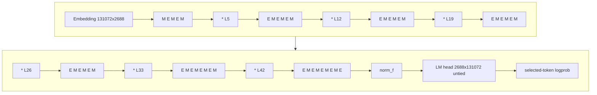
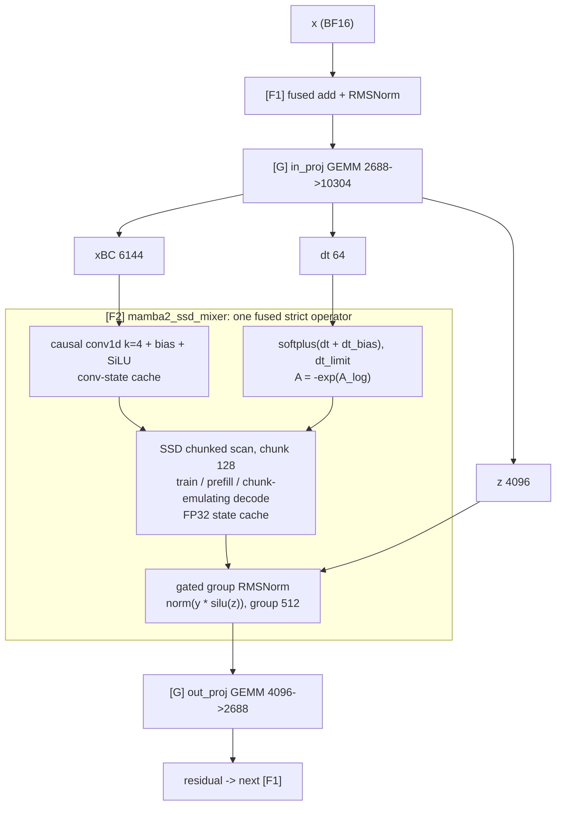

# Nemotron-3-Nano-30B-A3B

Status: Proposed
Target: post-v0.1.0 community roadmap

---

## 1. Motivation

`nvidia/NVIDIA-Nemotron-3-Nano-30B-A3B-BF16` is proposed as the first **recurrent-hybrid** target. It interleaves Mamba-2 (SSD) layers, sparse MoE layers and a small number of GQA attention layers. It adds three operator families the repo does not cover today:

1. **A linear recurrence with different train and rollout arithmetic.** Training computes Mamba-2 as a chunked parallel scan, while rollout decode computes it as a per-token recurrent state update. For this operator, "batch invariant" has to cover *how the sequence is split* (prefill length, decode steps, packing), not only which rows share a batch (§4.3).
2. **Stateful, non-paged caches.** Each Mamba layer keeps a depthwise causal-conv state and a fixed-size FP32 SSM state per sequence.
3. **Sigmoid-routed fine-grained MoE.** 128 routed experts + 1 shared expert, top-6 selection, selection-only bias correction, routed scaling, and a non-gated squared-ReLU expert MLP.

### Goal:

> Given the same logical tokens, weights, positions, masks and sampling context, training and rollout must execute the same declared arithmetic contract and produce exactly equal selected-token log-probabilities in strict mode.

**Two phases**:
- **Phase A: full text model.** Fused strict operators and TP/CP/EP invariance for all 52 layers.
- **Phase B: serving features and variants.** Mamba prefix-cache reuse and the FP8 checkpoint variant.

---

## 2. Checkpoint fingerprint

Pin the implementation to the exact checkpoint revision used by each validation run. Values below are from `config.json` and `modeling_nemotron_h.py` at revision `bf77c31`.

| Item | Value |
| --- | --- |
| Architecture | `NemotronHForCausalLM` (`model_type: nemotron_h`) |
| dtype | BF16 |
| Hidden size | 2688 |
| Decoder layers | 52 |
| Layer schedule (`hybrid_override_pattern`) | `MEMEM*EMEMEM*EMEMEM*EMEMEM*EMEMEM*EMEMEMEM*EMEMEMEME` |
| Layer counts | 23 × Mamba-2 (`M`), 23 × MoE (`E`), 6 × attention (`*`) |
| Attention layer indices (0-based) | 5, 12, 19, 26, 33, 42 |
| Block structure | one mixer per layer: `x + mixer(RMSNorm(x))`; no separate FFN sub-block |
| Norm | RMSNorm, FP32 compute, FP32 weight, eps 1e-5; final `norm_f` before LM head |
| `residual_in_fp32` | false |
| Vocabulary | 131072 |
| Input/output embedding | **untied**, no embedding scaling |
| Final logits | BF16 LM-head GEMM, then `.float()`; no softcap |
| **Attention** | |
| Q heads / KV heads / head dim | 32 / 2 / 128 (GQA, 16 Q heads per KV head) |
| Q / K / V / O shapes | 2688→4096, 2688→256, 2688→256, 4096→2688 |
| Positional encoding | **none (NoPE)**. `rope_theta: 10000` appears in config but the reference model never applies it |
| Mask | full causal; `sliding_window: null` |
| **Mamba-2 (SSD)** | |
| Heads / head dim / d_inner | 64 / 64 / 4096 |
| SSM state size / B,C groups | 128 / 8 |
| `in_proj` | 2688→10304, split order `[z: 4096, xBC: 6144, dt: 64]` |
| conv1d | depthwise over `conv_dim = 6144`, kernel 4, with bias, SiLU |
| Discretization | `dt = softplus(dt + dt_bias)`, optional `dt_limit`; `A = -exp(A_log)` in FP32; `D` skip |
| Chunk size | 128 |
| Output norm | gated group RMSNorm `norm(y · silu(z))` (`norm_before_gate=False`), group size 512 (8 groups over 4096) |
| `out_proj` | 4096→2688 |
| SSM cache dtype | FP32 (`mamba_ssm_cache_dtype`) |
| **MoE** | |
| Routed / shared experts / top-k | 128 / 1 / 6 |
| Router | FP32 GEMM 2688→128, **sigmoid** scores |
| Selection | top-6 on `score + e_score_correction_bias` (bias for selection only), `n_group=1`, `topk_group=1` |
| Weights | gathered un-biased scores, normalized (`norm_topk_prob`), × `routed_scaling_factor = 2.5` |
| Expert MLP | **non-gated** `down(relu²(up(x)))`, 2688→1856→2688 |
| Shared expert | same form, 2688→3712→2688; added after routed combine |
| **Not present in this checkpoint** | MTP layers, LatentMoE, NVFP4 weights, sliding window, vision/audio path |

Upstream references:

- https://huggingface.co/nvidia/NVIDIA-Nemotron-3-Nano-30B-A3B-BF16/blob/main/config.json
- https://huggingface.co/nvidia/NVIDIA-Nemotron-3-Nano-30B-A3B-BF16/blob/main/modeling_nemotron_h.py
- vLLM `vllm/model_executor/models/nemotron_h.py` and its Mamba-2 mixer / SSD ops
- `state-spaces/mamba` (`mamba_chunk_scan_combined`, `mamba_split_conv1d_scan_combined`, `selective_state_update`, `layernorm_gated`)
- `Dao-AILab/causal-conv1d` (`causal_conv1d_fn`, `causal_conv1d_update`)
- Megatron-LM hybrid / Mamba layer spec
- Nemotron 3 Nano technical report: arXiv:2512.20848

### Upstream runtime status

- **vLLM:** Nemotron-H inference already exists. RL-Kernel needs strict operator binding, cache-alignment policy and runtime provenance, not a new serving implementation.
- **Megatron:** hybrid Mamba/attention/MoE layer specs exist upstream. RL-Kernel needs strict operator binding into that spec.
- **VIME:** a Nemotron-H provider in `vime_plugins/models/` must be verified at claim time. Unless one is found, treat it as new integration work.

### Reference-implementation hazards (never use as the strict oracle)

- **Three Mamba code paths.** Training without cache uses fused `mamba_split_conv1d_scan_combined` (conv + scan + gated norm + out_proj). Prefill uses `causal_conv1d_fn` + `mamba_chunk_scan_combined` + separate norm and out_proj. Decode uses `causal_conv1d_update` + `selective_state_update`.
- **Atomic MoE combine.** The MoE combine uses `index_add_`, which is atomic and order-nondeterministic.
- **Unspecified expert order.** `torch.topk(..., sorted=False)` leaves the order of selected experts unspecified.

The HF `torch_forward` path (naive SSD) is still useful as an **independent numerical reference**: `allclose` against an FP64 re-run.

---

## 3. Architecture map

### Layer schedule

**Figure 1: Nemotron-3-Nano layer schedule.** `M` = Mamba-2 mixer, `E` = MoE mixer, `*` = GQA attention (NoPE). Every layer is one pre-norm residual block.

### One Mamba-2 block and its fused-operator boundaries

**Figure 2: One Mamba-2 block.** `[G]` boxes reuse the deterministic GEMM track. `[F1]`/`[F2]` are fused strict operators; each is a single work item and a single PR (§5).

---

## 4. Acceptance contract

This RFC uses exactly two kinds of acceptance: **operator acceptance** for every fused operator and **parallelism acceptance** for TP and CP. All the contract details below serve these two.

### 4.1 Operator acceptance: batch invariance + performance

Every operator row in §5 lands in one PR that includes:

1. **Batch invariance (forward and backward where applicable).** The output for a logical row is bitwise-identical (`torch.equal`) under:
   - different batch sizes and batch positions;
   - for stateful operators (conv, SSD, attention KV cache), **sequence-split invariance**: the same token's output is identical whether it was produced in training (full sequence), prefill (any prompt length) or decode (any step, any preceding chunked-prefill split).
2. **Performance.**
   - Benchmark on real Nemotron-3-Nano shapes: rollout decode batch sizes, prefill lengths, and training micro-batch token counts.
   - Report latency/throughput against the native production path (upstream `mamba_ssm` / `causal-conv1d`, vLLM Nemotron-H ops, cuBLAS/hipBLASLt, the native MoE path).

The existing WS1 rules still define *how* invariance is achieved:

- fixed accumulator precision and fixed reduction order;
- no Split-K / Stream-K / split-KV / cross-CTA atomics unless the merge tree is fixed by contract;
- no TF32 or fast-math reassociation;
- casts only at declared epilogue points;
- fail closed on unsupported strict geometry instead of silently falling back.

### 4.2 Parallelism acceptance: TP, CP and EP invariance

- **TP invariance:** selected-token logprobs (and gradients, on the training side) at TP ∈ {2, 4, 8} are bitwise-equal to TP1.
- **CP invariance:** selected-token logprobs and gradients at CP ∈ {2, 4} are bitwise-equal to CP1.
- **EP invariance:** selected-token logprobs and gradients at EP ∈ {2, 4, 8} are bitwise-equal to EP1. EP1 is plain data parallelism, with every rank holding all 128 experts.
- **Combined topologies:** at least TP × CP, TP × EP and CP × EP are each checked on one topology.
- **Both sides independently.** Rollout (vLLM EP / DP-attention) and training (Megatron EP, optionally with expert tensor parallelism) may use different EP layouts. Each side must be EP-invariant on its own, so that parity does not depend on the two sides happening to choose the same layout.
- Runtime provenance records the TP/CP/EP topology, all-to-all backend and payload dtype, backend IDs, chunk-anchor policy and fallback state, so every claim can be read back from the run.

### 4.3 Platform acceptance

- **CUDA:** exact train/rollout selected-token logprob equality under the pinned contract.
- **ROCm:** the same exact equality. `mamba_ssm` / `causal-conv1d` availability on ROCm is checked at claim time. The strict SSD/conv kernels are expected to be in-repo Triton so they run on both platforms.

---

## 5. Work-item table

Status: 🙋 open → ⏳ in progress → 👀 in review → ✅ merged

**One row × one platform = one PR.** Modules that can be fused are grouped into a single fused-operator row, and each row has independent CUDA and ROCm tracks, so the two platforms can be claimed, reviewed and merged separately. Every operator row must satisfy §4.1 (batch invariance + performance), and every parallelism row must satisfy §4.2 (TP / CP / EP invariance). A row is not done until its validation lands with the implementation.

Reuse legend:

- **Reuse:** an existing Qwen3/Gemma kernel, after Nemotron-H shape qualification.
- **Extend:** existing infrastructure reused, plus Nemotron-H-specific semantics.
- **New:** a new strict operator or integration boundary.

### 5.1 Foundation

| Work item | What it does | Reuse / dependency | CUDA owner | CUDA PR | CUDA status | ROCm owner | ROCm PR | ROCm status |
| --- | --- | --- | --- | --- | --- | --- | --- | --- |
| nemotronh_arch_fingerprint | Freeze checkpoint revision, 52-layer `M/E/*` schedule, head/group geometry, NoPE, `in_proj` split order, untied head, router constants, cache dtypes; per-layer operator trace; land §4.3/§4.4 as a versioned contract doc (maintainer-owned) | New | @KJLdefeated |  | ⏳ | (same PR, platform-agnostic) |  | ⏳ |

### 5.2 Fused operators (acceptance: batch invariance + performance)

| Work item | Fuses | Reuse / dependency | CUDA owner | CUDA PR | CUDA status | ROCm owner | ROCm PR | ROCm status |
| --- | --- | --- | --- | --- | --- | --- | --- | --- |
| fused_add_rmsnorm | Residual add + block RMSNorm (FP32 compute/weight, eps 1e-5), also used for `norm_f`; fwd/bwd | Extend existing norm infra |  @Jungle430 |  | 🙋 |  |  | 🙋 |
| dense_gemm_qualification | Shape qualification of the deterministic GEMM for `in_proj` 2688→10304, `out_proj` 4096→2688, Q/K/V/O, shared expert 2688→3712→2688 | Reuse #180 + ROCm det-GEMM | @joielab  |  | 🙋 |  |  | 🙋 |
| mamba2_ssd_mixer | causal conv1d (prefill + decode state) + dt discretization + SSD chunked scan (train/prefill) + chunk-emulating decode + gated group RMSNorm, with SSM/conv state cache and packing anchor (§4.3); fwd/bwd | New (Triton) |  |  | 🙋 |  |  | 🙋 |
| nope_gqa_attention | Full causal NoPE GQA core (Q32/KV2, D128) + KV cache for the 6 attention layers, prefill / chunked-prefill / decode | Extend #240 / #230 |  |  | 🙋 |  |  | 🙋 |
| moe_router_dispatch | FP32 router GEMM + sigmoid + bias-corrected top-6 + tie-break/expert-id ordering + normalization × 2.5 + deterministic permutation; fwd/bwd (§4.4) | Extend DSV4 router/MoE infra (KLR) if landed, else New | @RichApple123  |  | 🙋 |  |  | 🙋 |
| moe_experts_combine | Grouped expert GEMM up with relu² epilogue + grouped down + fixed-order weighted combine + shared-expert add, single cast; fwd/bwd | Extend DSV4 grouped GEMM (BF16 path); #280 activation infra |  |  | 🙋 |  |  | 🙋 |
| lm_head_logprob | Embedding lookup (untied), LM head 2688→131072 fused with selected-token logprob (no softcap) | Extend #243 / #204 / #336 |  |  | 🙋 |  |  | 🙋 |

### 5.3 Model closeout

| Work item | What it does | Reuse / dependency | CUDA owner | CUDA PR | CUDA status | ROCm owner | ROCm PR | ROCm status |
| --- | --- | --- | --- | --- | --- | --- | --- | --- |
| full_model_chain | Full 52-layer model with real weights: train vs prefill vs decode parity, sequence-split sweeps (prompt length mod 128, chunked-prefill splits), first-drift localization per layer type (maintainer-owned) | Extend #315 | @KJLdefeated |  | ⏳ | @KJLdefeated |  | ⏳ |

### 5.4 Parallelism (acceptance: TP / CP / EP invariance)

| Work item | What it does | Reuse / dependency | CUDA owner | CUDA PR | CUDA status | ROCm owner | ROCm PR | ROCm status |
| --- | --- | --- | --- | --- | --- | --- | --- | --- |
| tp_invariance | TP2/TP4/TP8 == TP1: Mamba group sharding, attention KV-head replication (2 KV heads), MoE intermediate sharding, vocab-parallel logprob, all with fixed reduction order (§4.2) | Extend Qwen3 WS2, #241, #336 |  |  | 🙋 |  |  | 🙋 |
| cp_invariance | CP2/CP4 == CP1: sequential Mamba chunk-state handoff with 128-aligned shard boundaries and conv halo, deterministic CP attention merge; plus one TP × CP topology | New; extend #235 for attention |  |  | 🙋 |  |  | 🙋 |
| ep_all_to_all | Strict EP dispatch/combine transport, fwd/bwd: drop-free, canonical `(source_rank, source_token_idx)` ordering, declared BF16 payload, unweighted combine payload, source-rank fixed-order combine (§4.2.1). Acceptance as an operator: batch invariance + performance vs native a2a (NCCL / DeepEP-style) | Extend DSV4 EP/a2a work (KLR) if landed, else New |  |  | 🙋 |  |  | 🙋 |
| ep_invariance | EP2/EP4/EP8 == EP1 for logprobs and gradients, incl. the canonical expert weight-gradient reduction tree; TP × EP and CP × EP topologies; rollout-side (vLLM EP) and training-side (Megatron EP / ETP) each validated independently | New; depends on ep_all_to_all |  |  | 🙋 |  |  | 🙋 |

---

## 6. Recommended claim order

1. nemotronh_arch_fingerprint (maintainer; other rows start once it lands)
2. fused_add_rmsnorm / dense_gemm_qualification / lm_head_logprob (mostly reuse; unblocks the chain harness)
3. mamba2_ssd_mixer (critical path)
4. nope_gqa_attention
5. moe_router_dispatch → moe_experts_combine
6. full_model_chain (maintainer)
7. tp_invariance → cp_invariance → ep_all_to_all → ep_invariance. `ep_all_to_all` can start in parallel with step 5 if it reuses the DSV4 transport

Steps 3, 4 and 5 are independent and can be claimed in parallel. Within each step, the CUDA and ROCm PRs can also proceed in parallel.

---

## 7. Contribution notes

- **One row × one platform = one PR.** If a fused row is too large to review, it may land as a short stack of PRs, but the row is marked done only when the whole fused operator passes §4.1.
- **CUDA and ROCm PRs.** Both PRs of a row implement the same versioned contract and share the same test suite; only the kernels and the native performance baseline differ (e.g. cuBLAS / NCCL vs hipBLASLt / RCCL). Either platform may land first. Once both have landed, the §4.6 T3 cross-platform comparison for that row is run. A strict kernel written once in Triton for both platforms may be submitted as a single PR that fills both columns, but it must pass the full acceptance on each platform.
- **`mamba2_ssd_mixer` scope.** Train/prefill and decode belong to the same row and must share device functions. A PR that covers only the chunked training path does not close the row.
- **Performance.** Every operator PR reports numbers against the native path on declared Nemotron-3-Nano shapes, for both rollout decode and training. Include the chunk-emulating decode overhead for `mamba2_ssd_mixer`.
- **Oracles.** Parity uses `torch.equal` between two strict paths. Correctness uses `allclose` against an independent FP64 reference. Never test a kernel against an oracle that shares its code.
- **MoE ordering.** MoE PRs must state their expert-ordering and combine-ordering policy explicitly. "Deterministic on my GPU" is not a contract.
- **Fail closed.** Strict mode fails closed whenever the runtime cannot guarantee sequence-anchored chunks, for example with an unaligned chunked-prefill budget, unaligned CP shards, or an unsupported prefix-cache mode.

---

## 8. Open questions

1. **Kernel base.** Should the strict SSD kernel be derived from upstream `mamba_ssm` Triton kernels (same tiling, pinned configs) or written fresh for easier ROCm coverage?
2. **Performance targets.** Default target per operator: a fixed ratio to native, or "report only" until the first CUDA/ROCm perf closeout?
3. **Decode placement.** Should chunk-emulating decode live as an RL-Kernel vLLM custom op, or be contributed upstream behind a vLLM batch-invariant Mamba flag?
4. **Packing default.** 128-aligned pack offsets (simple, up to 127 padding tokens per sequence) or `cu_seqlens`-aware chunking?
5. **Router and a2a sharing.** Can `moe_router_dispatch` and `ep_all_to_all` share code verbatim with the DSV4 track (KLR)? Which transport backs strict EP: NCCL all-to-all, or a DeepEP-style kernel with its ordering pinned?
6. **Tolerance calibration.** Is 1.1 × native the right slack for T1/T2? Should the analytic caps in §4.6 be replaced wholesale by calibrated values after the first native measurement, or kept as hard upper bounds?

---

## 9. Out of scope: follow-up RFC for Nemotron 3 Super

Nemotron 3 Super/Ultra reuse the hybrid Mamba-attention MoE backbone and add operator families this RFC leaves out:

- **LatentMoE:** routing in a low-rank latent space.
- **MTP layers / native speculative decoding:** the multi-token verify step changes the rollout forward shape.
- **NVFP4 mixed precision:** the dequant contract should be designed jointly with the DSV4 MXFP4 work.

The Nano contracts (§4.3, §4.4) are designed so that Super only needs new rows, not revised contracts.

### If you are interested, just ping below!
